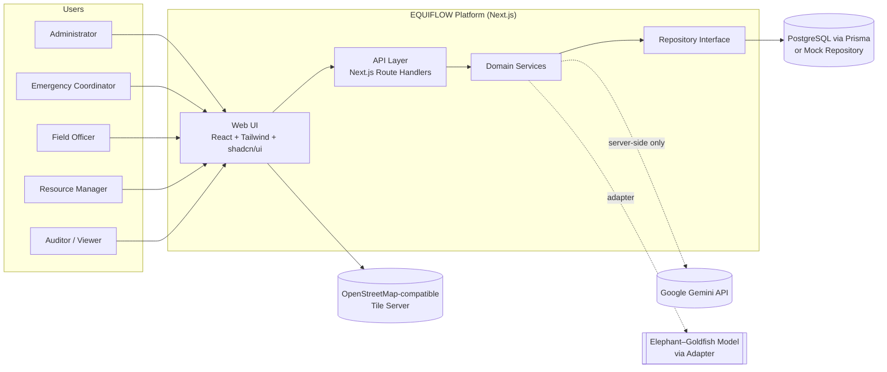
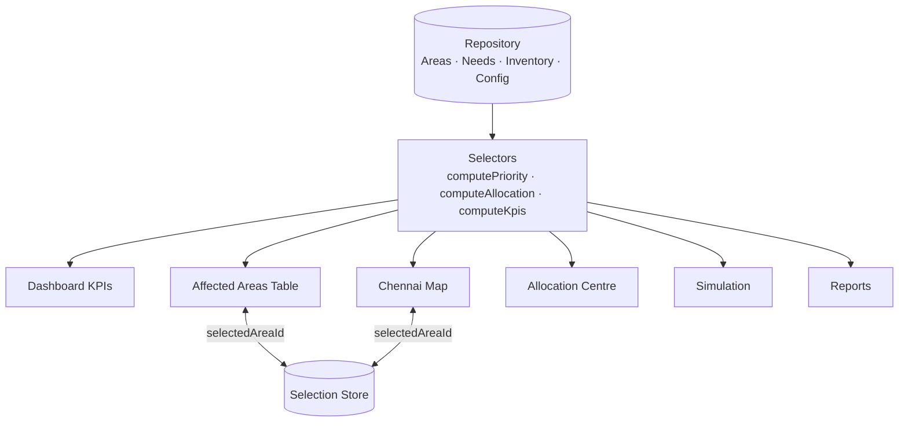
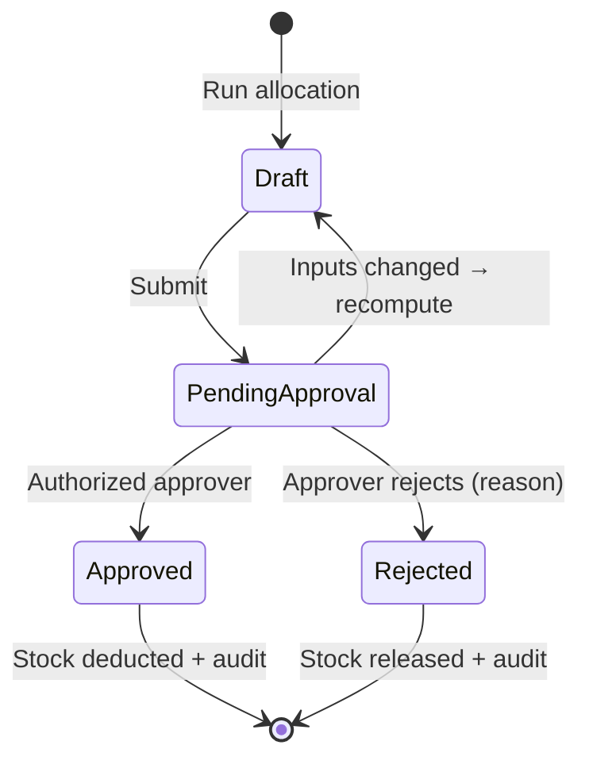

# EQUIFLOW — ULTIMATE BUILD DOCUMENT

**Contents**

- **Part A — Product Specification & Antigravity Build Instructions** (the original spec, sections A1–A20)
- **Part B — Design & System Architecture** (layers, services, data model, map sync, API, security, deployment)

**How to use:** Part A says *what* to build and the rules to follow. Part B says *how* it is structured. If the two ever disagree, Part A (the product spec) wins. Update Part B when an implementation decision changes.

---

# PART A — PRODUCT SPECIFICATION & ANTIGRAVITY BUILD INSTRUCTIONS

## A1. PROJECT OVERVIEW

**Project Name:** EQUIFLOW  
**Domain:** Responsible AI & Resource Optimization  
**Project Type:** AI-Powered Emergency Resource Distribution Platform  
**AI Provider:** Google Gemini API  
**Primary Demonstration City:** Chennai, Tamil Nadu, India  
**Demo Mode:** Seeded Mock Data  
**Development Environment:** Google Antigravity

### What is EQUIFLOW?

EQUIFLOW is an AI-powered platform designed to distribute limited emergency resources fairly among affected communities based on their needs, urgency, vulnerability, and available resources.

During floods, natural disasters, and other emergencies, resources such as food, drinking water, medicines, and shelter are limited.

Equal distribution does not necessarily mean fair distribution.

EQUIFLOW calculates the needs of different affected communities, assigns transparent priority scores, and recommends resource allocations using AI-assisted assessment and optimization algorithms.

Its primary objective is:

**To ensure that essential resources reach the communities that need them most, with fairness, transparency, and efficiency.**

---

## A2. IMPORTANT INSTRUCTIONS TO ANTIGRAVITY

You must treat this document as the primary product specification.

### Existing project preservation

1. First inspect the complete existing project.
2. Identify the existing framework, components, dependencies, source files, and architecture.
3. Inspect the already included Elephant–Goldfish model.
4. Understand the existing implementation before modifying anything.
5. Preserve all working functionality.
6. Do not unnecessarily replace the existing architecture.
7. Do not create a second application alongside the existing application.
8. Extend the existing project wherever possible.

### Build requirements

Build a complete, functional, industry-oriented web application.

Do not create only:
- A landing page.
- A static dashboard.
- A frontend prototype.
- A collection of disconnected pages.
- A non-functional map.
- A fake AI interface.

Every major feature must work and share the same underlying data.

### Mandatory technology requirements

- Use Google Gemini API for AI-assisted need assessment.
- Integrate the existing Elephant–Goldfish model after inspecting its actual implementation.
- Use a deterministic priority-scoring algorithm.
- Use an optimization algorithm for resource allocation.
- Use realistic seeded mock data for the demonstration.
- Use a real Chennai geographic map.
- Synchronize every map marker with the mock-data records.
- Support desktop, tablet, and mobile.
- Include proper validation, loading states, error handling, and testing.

### Critical instruction

Do not allow Gemini to independently decide final allocation quantities.

Gemini should assist with understanding needs, reports, and explanations.

The deterministic priority engine and resource-allocation algorithm must control the actual allocation constraints.

If Gemini is unavailable, the application must continue working through deterministic fallback logic.

---

## A3. ELEPHANT–GOLDFISH MODEL

The project already contains the Elephant–Goldfish model.

You must use the supplied model as part of this project rather than ignoring or replacing it.

Instructions:

1. Find the existing model files.
2. Read the available documentation.
3. Understand its actual purpose and inputs/outputs.
4. Identify where it can contribute to the EQUIFLOW architecture.
5. Integrate it through a separate adapter.
6. Validate its outputs before using them.
7. Keep the priority and allocation engines independent of its availability.
8. Implement fallback behaviour if the model cannot load.

Do not invent the model's capabilities.

Create:

`docs/elephant-goldfish-model.md`

Document:
- What the supplied model actually does.
- How it is integrated.
- Its inputs and outputs.
- Its role in EQUIFLOW.
- Its limitations.
- Its fallback behaviour.

If its implementation is incomplete, clearly document the missing integration rather than pretending it works.

---

## A4. TECHNOLOGY STACK

Inspect the existing project first. Preserve the current stack if it is appropriate.

If a replacement or additional technology is genuinely required, prefer:

| Layer | Technology |
|---|---|
| Frontend | Next.js / React |
| Language | TypeScript |
| Styling | Tailwind CSS |
| UI Components | shadcn/ui |
| Backend | Next.js API routes |
| AI | Google Gemini API |
| Map | Leaflet with OpenStreetMap-compatible tiles |
| Charts | Recharts |
| Database | PostgreSQL |
| ORM | Prisma |
| Validation | Zod |
| Testing | Vitest and Playwright |
| Deployment | Docker-compatible deployment |

Avoid unnecessary dependencies.

Keep the Gemini API key on the backend.

Never expose API credentials in frontend JavaScript.

---

## A5. APPLICATION MODULES

Create the following functional modules.

### Module 1: Operations Dashboard

Display:

- Total affected population.
- Total affected areas.
- Critical-priority communities.
- High-priority communities.
- Total available resources.
- Total requested resources.
- Total allocated resources.
- Remaining stock.
- Unmet demand.
- Pending allocation approvals.
- Recent emergency activity.

All dashboard values must come from the same data source.

Do not hardcode dashboard numbers independently.

### Module 2: Affected Areas

Display all affected communities in a searchable and filterable table.

Each record should contain:

- Area ID.
- Area name.
- Latitude and longitude.
- Affected population.
- Number of households.
- Severity.
- Urgency.
- Vulnerability.
- Resource requirements.
- Priority score.
- Priority category.
- Verification status.

Selecting an area must open its detailed information.

### Module 3: AI Need Assessment

Use Gemini API to:

- Understand submitted emergency reports.
- Extract possible resource requirements.
- Identify missing information.
- Summarize emergency conditions.
- Suggest severity and urgency values for human review.
- Explain why an area has received a particular priority score.

AI-generated suggestions must be clearly labelled and verified before affecting operational decisions.

### Module 4: Resource Inventory

Manage:

- Food packs.
- Drinking water.
- Medical kits.
- Shelter kits.
- Hygiene kits.

Show:

- Total quantity.
- Available quantity.
- Reserved quantity.
- Allocated quantity.
- Unmet demand.
- Unit of measurement.

Never mix different measurement units.

### Module 5: Allocation Centre

This is one of the most important modules.

The allocation centre must:

1. Read the affected-area requests.
2. Calculate priority scores.
3. Read current inventory.
4. Calculate resource-specific unmet needs.
5. Run the allocation algorithm.
6. Display recommended quantities.
7. Show unmet demand.
8. Explain why resources were allocated.
9. Allow authorized human approval.
10. Record every decision.

### Module 6: Geographic Map

Display affected communities on a real geographic map.

Use Chennai as the initial operating city.

Map requirements are explained in Section A8.

### Module 7: What-If Simulation

Allow operators to modify:

- Available food.
- Available water.
- Available medical kits.
- Affected population.
- Severity.
- Urgency.
- Community requirements.

Show how allocations change when these values are modified.

Simulation must not overwrite the original demo data unless the operator explicitly applies the scenario.

### Module 8: Shortage Monitoring

Show:

- Resources likely to become insufficient.
- Communities with unmet demand.
- Stock consumption estimates.
- Projected shortages.
- Recommended replenishment.

Clearly identify forecasts as estimates based on stated assumptions.

### Module 9: Reports and Audit

Provide:

- Allocation history.
- Priority-score history.
- Resource distribution reports.
- Fairness metrics.
- Manual override history.
- AI assessment history.

Every manual override must include a reason.

---

## A6. PRIORITY SCORE CALCULATION

This is a core part of EQUIFLOW.

Do not generate random scores.

Do not let Gemini invent numeric priority scores.

Implement a transparent, deterministic mathematical formula.

### Priority factors

| Factor | Weight | Explanation |
|---|---:|---|
| Severity | 30% | Seriousness of the emergency |
| Urgency | 25% | How quickly assistance is needed |
| Vulnerability | 20% | Presence of vulnerable affected populations |
| Unmet Need | 15% | Difference between requested and locally available resources |
| Population Impact | 10% | Number of people affected |

### Formula

Priority Score =

(Severity × 0.30) +

(Urgency × 0.25) +

(Vulnerability × 0.20) +

(Unmet Need × 0.15) +

(Population Impact × 0.10)

Every input must be normalized to a value between 0 and 100.

### Example

Suppose a community has:

- Severity = 90
- Urgency = 85
- Vulnerability = 70
- Unmet Need = 80
- Population Impact = 60

Calculation:

(90 × 0.30) + (85 × 0.25) + (70 × 0.20) + (80 × 0.15) + (60 × 0.10)

= 27 + 21.25 + 14 + 12 + 6

= 80.25

Final score = 80.3

Priority category = CRITICAL.

### Priority categories

| Score | Category | Colour |
|---|---|---|
| 80–100 | Critical | Dark Red |
| 60–79.9 | High | Red |
| 40–59.9 | Moderate | Amber |
| 0–39.9 | Low | Green |

Use these same categories everywhere in the application.

### Important scoring rules

- Missing data must not automatically become zero.
- Unknown values must be identified.
- Unverified values must show lower confidence.
- Vulnerable population groups must not be double-counted.
- Population impact must use a capped normalization method.
- Score calculations must be explainable.
- Save the component breakdown for every score.
- Version the scoring formula.

The weights are initial policy defaults and must be configurable through an authorized administrative process.

---

## A7. FAIR RESOURCE ALLOCATION ALGORITHM

Implement resource allocation based on priority scores and actual resource requirements.

Do not simply distribute the available resources equally.

Do not allocate all resources to the community with the highest score.

### Allocation process

Step 1: Collect all valid community requirements.

Step 2: Calculate each community's priority score.

Step 3: Calculate resource-specific unmet demand.

Step 4: Check available inventory.

Step 5: Apply minimum essential coverage rules where possible.

Step 6: Allocate remaining resources according to weighted unmet demand.

Step 7: Respect stock limits and demand limits.

Step 8: Calculate shortages.

Step 9: Run fairness checks.

Step 10: Display allocation recommendations.

### Suggested allocation weight

For each area and resource:

Allocation Weight =

(0.50 × Overall Priority / 100 +

0.30 × Resource Urgency / 100 +

0.20 × Vulnerability / 100)

× Eligible Unmet Demand

Use this weight to distribute remaining stock proportionally.

### Mandatory constraints

- Never allocate more than available stock.
- Never allocate more than eligible unmet demand.
- Keep resource units separate.
- Account for reserved and unavailable stock.
- Use deterministic rounding for indivisible items.
- Do not silently discard leftover stock.
- Record all unfulfilled requirements.
- Provide minimum coverage where feasible and authorized.
- Use a stable tie-breaking rule.

### Fairness evaluation

Display:

- Percentage of demand satisfied.
- Critical areas receiving assistance.
- Minimum coverage achieved.
- Allocation per affected person where meaningful.
- Unmet demand by priority category.
- Differences in coverage among similarly situated areas.

Fairness does not mean identical distribution.

It means justified distribution based on needs and operational constraints.

---

## A8. CHENNAI MAP — IMPORTANT REQUIREMENT

The map must be a genuine geographic map, not an illustration.

Use a real Chennai basemap with recognizable roads, neighbourhoods, and geographic features.

Use Leaflet or MapLibre.

### City configuration

Default city:

Chennai, Tamil Nadu, India.

The initial request also mentions Coimbatore. These instructions conflict, so keep the city configurable. Use Chennai as the default unless the project owner changes it to Coimbatore.

### Demo affected locations

Use plausible Chennai coordinates for mock records.

| ID | Area | Latitude | Longitude |
|---|---|---:|---:|
| CHN-001 | Adyar | 13.0067 | 80.2570 |
| CHN-002 | Velachery | 12.9750 | 80.2210 |
| CHN-003 | Saidapet | 13.0210 | 80.2230 |
| CHN-004 | Perungudi | 12.9600 | 80.2430 |
| CHN-005 | T. Nagar | 13.0418 | 80.2341 |
| CHN-006 | Mylapore | 13.0330 | 80.2690 |
| CHN-007 | Anna Nagar | 13.0850 | 80.2101 |

These are simulated locations, not real emergency reports.

### Map marker colours

- Critical: Dark red.
- High: Red.
- Moderate: Amber.
- Low: Green.

### Map functionality

Every marker must show:

- Area name.
- Priority score.
- Priority category.
- Affected population.
- Resource requirements.

When clicking a marker:

- Open the corresponding area details.
- Highlight that area in the affected-area list.
- Show its resource requirements.
- Show its priority-score breakdown.

When selecting an area from the list:

- Focus the map on the corresponding marker.

### Synchronization requirement

This is extremely important.

The map must use the same underlying mock data as:

- Dashboard.
- Priority table.
- Resource inventory.
- Allocation centre.
- Simulation.
- Reports.

If an area priority changes, its map colour and displayed score must change automatically.

If an area is added, its marker must appear automatically.

If an area is removed or deactivated, the map must reflect that change.

Never maintain separate hardcoded map data.

Provide a map legend and a textual alternative for accessibility.

Clearly show:

**DEMO MODE — SIMULATED EMERGENCY DATA**

---

## A9. MOCK DATA REQUIREMENTS

The complete application must work using mock data.

The demo should be clean, realistic, consistent, and reproducible.

Seed at least seven affected communities.

Each community must have:

- Unique ID.
- Name.
- Coordinates.
- Population.
- Household count.
- Severity.
- Urgency.
- Vulnerability.
- Food requirement.
- Water requirement.
- Medical requirement.
- Shelter requirement.
- Hygiene requirement.
- Local supply information.
- Verification status.

### Initial resource inventory

| Resource | Unit | Mock Stock |
|---|---|---:|
| Food | Packs | 8,000 |
| Water | Litres | 30,000 |
| Medical kits | Kits | 1,200 |
| Shelter kits | Kits | 2,000 |
| Hygiene kits | Kits | 2,500 |

These are demo values.

Create enough demand to demonstrate resource shortages and constrained allocations.

### Mock data consistency

All UI values must be calculated from the same data.

Do not hardcode separate numbers for:

- Dashboard cards.
- Charts.
- Tables.
- Map markers.
- Allocation results.
- Reports.

Use one shared repository or state-management layer.

### Demo reset

Provide a Reset Demo Data button.

After confirmation, restore:

- Original requests.
- Original inventory.
- Original allocations.
- Original priority values.
- Original simulation state.
- Original alerts.
- Original audit baseline.

---

## A10. GEMINI API INTEGRATION

Use the Google Gemini API.

### Gemini responsibilities

- Understand emergency reports.
- Extract possible resource requirements.
- Summarize community needs.
- Identify missing information.
- Suggest severity and urgency for human review.
- Explain calculated priority scores.
- Summarize allocation decisions.
- Generate situation reports.

### API architecture

Frontend → Backend API → Gemini API → Schema Validation → Application Services.

Keep the Gemini key in a server-side environment variable.

Example:

GEMINI_API_KEY=

Never place it in frontend code.

### Structured AI output

Require Gemini to return structured JSON.

Example:

```json
{
  "summary": "Severe flooding reported",
  "suggestedNeeds": [
    {
      "resourceType": "water",
      "quantity": 5000,
      "unit": "litres",
      "confidence": "high",
      "evidence": "Reported shortage of drinking water"
    }
  ],
  "missingInformation": [],
  "contradictions": [],
  "suggestedSeverity": 90,
  "suggestedUrgency": 85,
  "explanation": "Immediate support is recommended"
}
```

Validate every response before using it.

AI suggestions must be reviewed before becoming verified operational inputs.

### Failure handling

If Gemini fails:

- Do not crash the application.
- Display an understandable warning.
- Use deterministic fallback behaviour.
- Keep priority calculations working.
- Keep allocation calculations working.
- Record the AI service status.

---

## A11. USER INTERFACE DESIGN

The application must look like a real emergency-management and resource-logistics product.

Do not use a generic AI-themed design.

Avoid:
- Excessive gradients.
- Neon colours.
- Glowing cards.
- Robot illustrations.
- Futuristic AI backgrounds.
- Excessive animations.
- Unnecessary decorative elements.

### Suggested colours

| Element | Colour |
|---|---|
| Primary navy | #172B4D |
| Background | #F6F8FA |
| Cards | #FFFFFF |
| Primary teal | #167D83 |
| Critical | #B42318 |
| High | #E04444 |
| Moderate | #D99118 |
| Low | #23865B |
| Text | #263445 |
| Borders | #DCE2E8 |

### Navigation

Create:

1. Overview
2. Affected Areas
3. Resource Inventory
4. Allocation Centre
5. Map View
6. Simulations
7. Reports & Audit
8. Settings

### Dashboard layout

Desktop:
- Sidebar.
- Header.
- KPI cards.
- Geographic map.
- Priority list.
- Resource inventory summary.
- Allocation charts.
- Recent activity.

Mobile:
- Responsive navigation.
- Two-column or scrollable KPI cards.
- Touch-friendly map.
- Stacked area details.
- Responsive tables.
- No horizontal overflow.
- Buttons sized for touch.
- Readable text and charts.

### Accessibility

Target WCAG 2.2 AA.

Use:
- Keyboard navigation.
- Visible focus indicators.
- Semantic HTML.
- Proper contrast.
- Accessible labels.
- Text descriptions alongside colour indicators.
- Reduced-motion support.

---

## A12. DATABASE AND DATA ARCHITECTURE

Use a shared typed data model.

Suggested entities:

- Users
- Areas
- Incidents
- NeedRequests
- Assessments
- Resources
- InventoryBatches
- AllocationRuns
- AllocationItems
- Approvals
- Simulations
- AuditEvents
- AIAnalyses

Create separate services for:

- Priority calculation.
- Resource allocation.
- Fairness evaluation.
- Gemini integration.
- Elephant–Goldfish integration.
- Mock-data management.
- Map data retrieval.

Use database transactions when reserving or approving stock.

Prevent concurrent allocations from exceeding available stock.

For the demo, mock data can be used through the same repository interface that will later connect to PostgreSQL.

---

## A13. WHAT-IF SIMULATION

Create a working simulation module.

Example:

Current available food stock = 8,000 packs.

An operator changes the stock to 5,000 packs.

The system should:

1. Recalculate the allocation.
2. Identify newly created shortages.
3. Show changes in each community's allocation.
4. Update the simulated map.
5. Show baseline and scenario comparisons.
6. Display which communities are most affected.

Do the same for water, medical kits, shelter kits, population, and urgency.

Simulation changes must remain isolated from the baseline dataset until explicitly applied.

---

## A14. SHORTAGE PREDICTION

Use transparent calculations.

For example:

If the average daily water requirement is 5,000 litres and available water is 20,000 litres:

Estimated supply duration = 20,000 / 5,000 = 4 days.

Show:

- Available stock.
- Estimated daily consumption.
- Estimated remaining duration.
- Projected shortage date.
- Communities at risk.

Allow operators to change consumption assumptions.

Clearly label predictions as estimates, not guaranteed forecasts.

---

## A15. SECURITY AND RESPONSIBLE AI

Implement:

- Role-based access control.
- Server-side API keys.
- Input validation.
- Request-size limits.
- Rate limiting.
- Secure error handling.
- Audit logging.
- Data minimization.
- Human approval for operational allocations.
- Explainable scoring.
- Manual correction mechanisms.

Suggested roles:

- Administrator.
- Emergency Coordinator.
- Field Officer.
- Resource Manager.
- Auditor.
- Viewer.

Do not use sensitive personal data in mock records.

Do not allow AI-generated decisions to bypass allocation constraints.

Provide explanations for decisions and allow authorized personnel to correct inaccurate information.

---

## A16. TESTING REQUIREMENTS

Create unit, integration, and end-to-end tests.

### Priority tests

- Correct weighted score.
- Score boundaries.
- Priority category assignment.
- Missing data.
- Invalid inputs.
- Score recalculation.

### Allocation tests

- Available-stock constraint.
- Demand constraint.
- Fairness checks.
- Rounding.
- Unmet demand.
- Tie-breaking.
- Stock updates.

### Gemini tests

- Valid JSON response.
- Invalid JSON response.
- API timeout.
- Missing API key.
- Fallback behaviour.

### Map tests

- Every active area has a valid marker.
- Marker score matches calculated score.
- Marker colour matches priority category.
- Selecting an area highlights the correct marker.
- Filtering updates map and list together.

### Mobile tests

Test at:
- 360px.
- 390px.
- 768px.
- 1024px.
- Desktop widths.

### Final quality checks

Run the actual project commands:

```bash
npm run lint
npm run typecheck
npm run test
npm run build
```

Also run end-to-end tests where configured.

Fix errors before considering implementation complete.

Do not disable checks just to make the build pass.

---

## A17. IMPLEMENTATION ORDER

Follow this order.

### Phase 1 — Existing project inspection

- Inspect project structure.
- Inspect Elephant–Goldfish model.
- Identify existing technologies.
- Preserve working code.
- Establish implementation plan.

### Phase 2 — Data foundation

- Create typed data models.
- Create mock data.
- Create Chennai coordinates.
- Create inventory.
- Create shared repository.

### Phase 3 — Core intelligence

- Implement priority scoring.
- Implement resource-specific needs.
- Implement allocation algorithm.
- Implement fairness checks.
- Add unit tests.

### Phase 4 — Main frontend

- Build dashboard.
- Build navigation.
- Build affected-area management.
- Build resource inventory.
- Build responsive design.

### Phase 5 — Map integration

- Integrate genuine Chennai basemap.
- Add affected-area markers.
- Connect markers to shared records.
- Add priority colours.
- Add selection synchronization.
- Test mobile map behaviour.

### Phase 6 — AI integration

- Integrate Gemini API.
- Add structured response validation.
- Add AI-assisted summaries.
- Add missing-data detection.
- Integrate Elephant–Goldfish model through the verified adapter.
- Add fallback behaviour.

### Phase 7 — Allocation and simulation

- Build allocation centre.
- Add approval workflow.
- Add fairness metrics.
- Add what-if simulation.
- Add shortage prediction.
- Add audit history.

### Phase 8 — Final testing

- Run all tests.
- Fix frontend errors.
- Fix backend errors.
- Fix map synchronization.
- Verify Gemini integration.
- Verify mobile compatibility.
- Verify production build.

---

## A18. REQUIRED PROJECT DOCUMENTATION

Create an `idea-description` folder in the project root.

Inside it, create:

```text
idea-description/
│
├── EQUIFLOW_BUILD_SPEC.md
├── PRODUCT_OVERVIEW.md
├── PROBLEM_STATEMENT.md
├── TECHNOLOGY_STACK.md
├── SYSTEM_ARCHITECTURE.md
├── PRIORITY_SCORING.md
├── RESOURCE_ALLOCATION.md
├── GEMINI_API_INTEGRATION.md
├── ELEPHANT_GOLDFISH_INTEGRATION.md
├── MOCK_DATA_SPECIFICATION.md
├── MAP_AND_GEOLOCATION.md
├── DATABASE_DESIGN.md
├── IMPLEMENTATION_PLAN.md
├── SECURITY_AND_RESPONSIBLE_AI.md
└── TESTING_AND_DEPLOYMENT.md
```

All documentation must describe the actual implementation. Update it when implementation decisions differ from this initial specification.

---

## A19. FINAL ACCEPTANCE CRITERIA

The project is considered complete only when all the following work:

1. Dashboard loads correctly.
2. All mock data is consistent.
3. Chennai map displays correctly.
4. Affected communities appear as geographic markers.
5. Marker colours correspond to priority scores.
6. Clicking a marker opens the matching area.
7. Priority scores are mathematically calculated.
8. Priority breakdowns are visible.
9. Resource allocation respects stock limits.
10. Unmet demand is displayed.
11. Fairness metrics are calculated.
12. Gemini API works when configured.
13. Gemini failure does not break the application.
14. Elephant–Goldfish integration reflects its actual supplied capabilities.
15. What-if simulation works.
16. Shortage monitoring works.
17. Audit history is maintained.
18. Reset demo restores the original state.
19. Desktop UI works.
20. Mobile UI works.
21. Build, lint, type-check, and tests pass.

---

## A20. MOST IMPORTANT FINAL INSTRUCTION

Do not stop after reading this document.

Do not only generate a development plan.

Do not only create documentation.

**Actually implement EQUIFLOW in the existing project.**

Start by inspecting the repository and the included Elephant–Goldfish model.

Then implement each phase in order.

Use Gemini API for AI-assisted assessment, deterministic mathematics for priority scoring, and a constrained optimization algorithm for resource allocation.

Use a genuine Chennai map and connect every affected-area marker to the shared mock-data source.

Make the entire application responsive, professional, explainable, and testable.

If an external service or model is unavailable, implement a clearly labelled fallback instead of leaving a broken feature.

Do not claim that a feature is completed unless it has been implemented and tested.

**Final goal: Deliver a complete, working EQUIFLOW emergency resource-management platform—not merely a prototype or dashboard.**


---

# PART B — DESIGN & SYSTEM ARCHITECTURE


### B1. Architecture Principles

| # | Principle | Consequence in design |
|---|---|---|
| 1 | **Single source of truth** | Dashboard, tables, map, allocation, simulation, and reports all read from one repository/state layer. No hardcoded per-screen numbers. |
| 2 | **Deterministic core, AI at the edge** | Priority scoring and allocation are pure, testable functions. Gemini only assists (parsing, summarizing, suggesting, explaining). |
| 3 | **AI never decides quantities** | Gemini output is schema-validated, labelled "AI suggestion", and requires human review before becoming a verified input. |
| 4 | **Graceful degradation** | If Gemini or the Elephant–Goldfish model is down, scoring and allocation still work via deterministic fallbacks. |
| 5 | **Isolation of scenarios** | Simulations run on a cloned dataset and never touch baseline data until explicitly applied. |
| 6 | **Explainability and auditability** | Every score stores its component breakdown and formula version; every decision and override is logged with a reason. |
| 7 | **Repository abstraction** | Mock data and PostgreSQL implement the same interface so the demo can move to a real DB without touching services or UI. |
| 8 | **Secrets stay server-side** | `GEMINI_API_KEY` is read only in backend code. |

---

### B2. High-Level System Context



---

### B3. Layered Architecture

```
┌──────────────────────────────────────────────────────────────┐
│ PRESENTATION LAYER                                            │
│  Pages · Layout shell · KPI cards · Tables · Leaflet map ·    │
│  Charts (Recharts) · Forms · Dialogs                          │
├──────────────────────────────────────────────────────────────┤
│ CLIENT STATE / DATA LAYER                                     │
│  Query cache (fetch hooks) · Selection store (selectedAreaId, │
│  filters, scenarioId) · Derived selectors                     │
├──────────────────────────────────────────────────────────────┤
│ API LAYER (server)                                            │
│  Route handlers · Zod validation · RBAC guard · Rate limiter  │
│  · Request-size limit · Error normalizer · Audit hook         │
├──────────────────────────────────────────────────────────────┤
│ DOMAIN SERVICE LAYER (pure TypeScript, framework-free)        │
│  PriorityService · AllocationService · FairnessService ·      │
│  SimulationService · ShortageService · ReportService ·        │
│  AuditService · MockDataService                               │
├──────────────────────────────────────────────────────────────┤
│ INTEGRATION LAYER                                             │
│  GeminiClient (+ schema validator + fallback) ·               │
│  ElephantGoldfishAdapter (+ output validator + fallback)      │
├──────────────────────────────────────────────────────────────┤
│ PERSISTENCE LAYER                                             │
│  Repository interface → MockRepository | PrismaRepository     │
└──────────────────────────────────────────────────────────────┘
```

**Dependency rule:** arrows point downward only. Domain services never import from UI, API, or integration modules; integrations are injected, so the priority and allocation engines run with zero AI availability.

---

### B4. Proposed Folder Structure

> Final layout must follow the *existing* project's conventions. This is the target mapping after inspection.

```
/
├── idea-description/                 # Documentation set (Section 18 of spec)
├── docs/
│   └── elephant-goldfish-model.md    # Written after inspecting the real model
├── prisma/
│   ├── schema.prisma
│   └── seed.ts
├── src/
│   ├── app/                          # Next.js App Router
│   │   ├── (dashboard)/
│   │   │   ├── overview/
│   │   │   ├── affected-areas/
│   │   │   ├── resource-inventory/
│   │   │   ├── allocation-centre/
│   │   │   ├── map-view/
│   │   │   ├── simulations/
│   │   │   ├── reports-audit/
│   │   │   └── settings/
│   │   └── api/
│   │       ├── areas/
│   │       ├── inventory/
│   │       ├── priority/
│   │       ├── allocations/
│   │       ├── simulations/
│   │       ├── shortages/
│   │       ├── ai/assess/
│   │       ├── reports/
│   │       ├── audit/
│   │       └── demo/reset/
│   ├── components/
│   │   ├── layout/ (Sidebar, Header, MobileNav, DemoBanner)
│   │   ├── dashboard/ (KpiCard, ActivityFeed, AllocationChart)
│   │   ├── areas/ (AreaTable, AreaDetail, ScoreBreakdown)
│   │   ├── map/ (ChennaiMap, AreaMarker, MapLegend, MapTextAlternative)
│   │   ├── allocation/ (RecommendationTable, FairnessPanel, ApprovalDialog)
│   │   └── ui/                       # shadcn/ui
│   ├── domain/
│   │   ├── types.ts                  # Shared typed model
│   │   ├── priority/                 # scoring formula + versioning
│   │   ├── allocation/               # algorithm + rounding + tie-break
│   │   ├── fairness/
│   │   ├── simulation/
│   │   ├── shortage/
│   │   └── audit/
│   ├── integrations/
│   │   ├── gemini/ (client, prompts, schema, fallback)
│   │   └── elephant-goldfish/ (adapter, validator, fallback)
│   ├── data/
│   │   ├── repository.ts             # Interface
│   │   ├── mock/ (seed, MockRepository)
│   │   └── prisma/ (PrismaRepository)
│   ├── lib/ (config, rbac, rate-limit, errors, logger)
│   └── hooks/ (useAreas, useInventory, useAllocation, useSelection)
├── tests/
│   ├── unit/
│   ├── integration/
│   └── e2e/                          # Playwright
└── Dockerfile / docker-compose.yml
```

---

### B5. Core Data Model

```mermaid
erDiagram
    USER ||--o{ AUDIT_EVENT : performs
    AREA ||--o{ NEED_REQUEST : submits
    AREA ||--o{ ASSESSMENT : has
    AREA ||--o{ PRIORITY_SNAPSHOT : scored_as
    INCIDENT ||--o{ AREA : affects
    NEED_REQUEST ||--o{ AI_ANALYSIS : analysed_by
    RESOURCE ||--o{ INVENTORY_BATCH : stocked_in
    ALLOCATION_RUN ||--o{ ALLOCATION_ITEM : contains
    ALLOCATION_ITEM }o--|| AREA : to
    ALLOCATION_ITEM }o--|| RESOURCE : of
    ALLOCATION_RUN ||--o{ APPROVAL : requires
    SIMULATION ||--|| ALLOCATION_RUN : produces
    USER ||--o{ APPROVAL : grants

    AREA {
      string id "CHN-001"
      string name
      float lat
      float lng
      int population
      int households
      int severity
      int urgency
      int vulnerability
      string verificationStatus
      bool active
    }
    PRIORITY_SNAPSHOT {
      string areaId
      float score
      string category
      json componentBreakdown
      string formulaVersion
      string confidence
      datetime computedAt
    }
    RESOURCE {
      string type "food|water|medical|shelter|hygiene"
      string unit "packs|litres|kits"
      int total
      int reserved
    }
    ALLOCATION_ITEM {
      string areaId
      string resourceType
      int recommendedQty
      int unmetQty
      string rationale
    }
```

#### Key typed entities

| Entity | Purpose | Notes |
|---|---|---|
| `Area` | Affected community | Source for table, map, dashboard. `active=false` removes marker. |
| `NeedRequest` | Per-resource requirement | Stored per resource with its own unit; never mixed. |
| `Assessment` | Human-verified severity/urgency/vulnerability | Only verified values drive scoring at full confidence. |
| `PriorityConfig` | Weights + formula version | Editable only by Administrator; versioned. |
| `AIAnalysis` | Raw + validated Gemini output | Status: `suggested → reviewed → accepted/rejected`. |
| `AllocationRun` | One computed recommendation set | Status: `draft → pending_approval → approved/rejected`. |
| `AuditEvent` | Immutable log | Includes override reason, actor, before/after. |

---

### B6. Domain Services (Deterministic Engines)

#### 6.1 PriorityService

```
Input:  Area, Assessment, NeedRequests, PriorityConfig (weights, version)
Output: { score, category, components[], confidence, unknownFields[], formulaVersion }
```

Formula (default weights, configurable):

```
Score = 0.30·Severity + 0.25·Urgency + 0.20·Vulnerability
      + 0.15·UnmetNeed + 0.10·PopulationImpact        (all inputs 0–100)
```

Design rules:

- **Normalization:** Population impact uses capped normalization: `min(population / popCap, 1) × 100`. `popCap` is part of the versioned config.
- **Unmet need:** `(requested − locallyAvailable) / requested × 100`, computed per resource then aggregated.
- **Missing data:** flagged in `unknownFields`; excluded from weighted sum with weights re-normalized, and confidence is lowered. Missing is never silently zero.
- **Unverified data:** confidence penalty (`high → medium → low`).
- **No double counting:** vulnerability is computed from a de-duplicated group set (a person in multiple groups counts once).
- **Output stored** as `PrioritySnapshot` with full component breakdown.
- **Category thresholds** are defined once in one module and imported by UI, map, charts, reports.

#### 6.2 AllocationService

Runs **per resource independently** (units never mixed).

```
for each resource R:
  1. eligible[a]   = unmet demand of area a for R (capped by stated need)
  2. usable stock  = total − reserved − unavailable
  3. MINIMUM COVERAGE PASS
       - give each eligible area a minimum share (policy: % of need, e.g. essential floor)
         in descending priority order until floor or stock exhausted
  4. WEIGHTED PASS on remaining stock
       weight[a] = (0.50·Priority/100 + 0.30·ResourceUrgency/100 + 0.20·Vulnerability/100)
                   × eligibleRemaining[a]
       share[a]  = remainingStock × weight[a] / Σ weight
       share[a]  = min(share[a], eligibleRemaining[a])
  5. REDISTRIBUTE spill-over (water-filling) from capped areas until stock or demand is exhausted
  6. DETERMINISTIC ROUNDING (largest remainder; ties → higher priority, then lower areaId)
  7. record unmet[a] = eligible[a] − allocated[a]; leftover stock reported, never discarded silently
```

Hard invariants (enforced by assertions and tests):

- `Σ allocated ≤ usable stock`
- `allocated[a] ≤ eligible unmet[a]`
- Same input → same output (no randomness, stable sort keys)
- Leftover stock is explicitly reported

#### 6.3 FairnessService

Computes from an `AllocationRun`:

- Demand satisfied % (overall, per resource, per priority category)
- Critical areas receiving assistance (count / total critical)
- Minimum coverage achieved (yes/no per area)
- Allocation per affected person (where meaningful)
- Unmet demand by category
- Coverage variance among similarly situated areas (same category, comparable need)

#### 6.4 SimulationService

```
baseline = repo.snapshot()
scenario = deepClone(baseline) + operatorOverrides
result   = Priority(scenario) → Allocation(scenario) → Fairness(scenario)
diff     = compare(baselineRun, scenarioRun)   // per-area, per-resource deltas
apply()  = explicit action; writes overrides to baseline + audit event
```

Scenarios live in their own store keyed by `scenarioId`; the map can switch between *Baseline* and *Scenario* view.

#### 6.5 ShortageService

```
dailyConsumption[R] = operator-adjustable assumption (default derived from demand/horizon)
daysRemaining[R]    = usableStock[R] / dailyConsumption[R]
projectedShortage   = today + daysRemaining
areasAtRisk         = areas with unmet > 0 or coverage below threshold
replenishment       = max(0, dailyConsumption × horizon − usableStock)
```

All outputs are labelled **"Estimate based on stated assumptions."**

---

### B7. Integration Layer

#### 7.1 Gemini Pipeline

```mermaid
sequenceDiagram
    participant UI
    participant API as /api/ai/assess
    participant G as GeminiClient
    participant V as Zod Validator
    participant S as AIAnalysis Store
    participant F as Fallback

    UI->>API: Emergency report text
    API->>API: Auth + RBAC + size limit + rate limit
    API->>G: Prompt (server-side key, JSON mode)
    alt Success within timeout
        G-->>API: Raw JSON
        API->>V: Validate schema
        alt Valid
            V-->>S: Save as "suggested"
            S-->>UI: Labelled AI suggestion
        else Invalid
            V-->>F: Fallback
        end
    else Timeout / error / missing key
        G-->>F: Failure
    end
    F-->>UI: Warning + rule-based extraction (keywords, manual form)
    UI->>API: Human review → accept / edit / reject
    API->>S: Mark reviewed; only accepted values become inputs
```

Responsibilities:

| Gemini does | Gemini does **not** do |
|---|---|
| Parse reports, extract possible needs | Compute priority scores |
| Flag missing info and contradictions | Decide allocation quantities |
| Suggest severity/urgency *for review* | Approve or reject allocations |
| Explain scores, summarize runs, draft situation reports | Change inventory |

Resilience: timeout, retry with backoff (bounded), response schema validation, prompt-injection-safe handling (report text treated as data), AI service status recorded in audit log and shown in the header.

#### 7.2 Elephant–Goldfish Adapter

> **Rule:** the model's capabilities are not assumed. Phase 1 inspects the supplied implementation and documentation; this section is finalized only after that.

```
ElephantGoldfishAdapter
 ├─ load()         → try to initialize model; report status (ready | unavailable)
 ├─ describe()     → real inputs/outputs discovered during inspection
 ├─ run(input)     → calls model through a narrow, typed interface
 ├─ validate(out)  → range/shape checks; reject anything invalid
 └─ fallback()     → returns "unavailable" result; core engines proceed unchanged
```

- Priority and allocation engines **do not import** the adapter. Its validated output is consumed only through an optional, clearly labelled advisory input (for example, an advisory signal shown beside an area) once its true purpose is confirmed.
- If the model is incomplete, `docs/elephant-goldfish-model.md` records exactly what is missing instead of simulating functionality.

---

### B8. Shared State & Synchronization (Map ↔ Everything)



Rules that make synchronization automatic:

1. The map renders **from the same `areas + priority snapshots` the table uses**. There is no separate marker file.
2. Marker color/score are derived: `category = categoryFor(score)` from the single shared module.
3. `selectedAreaId` lives in one store: clicking a marker highlights the table row and opens the detail panel; selecting a row calls `map.flyTo(area)`.
4. Filters live in one store, so table and map filter together.
5. Add / deactivate / edit an area → repository mutation → cache invalidation → markers re-render.
6. A runtime consistency check (and a Playwright test) asserts `marker.score === calculatedScore` and `marker.color === categoryColor(score)` for every active area.

---

### B9. Map Architecture

| Aspect | Design |
|---|---|
| Library | Leaflet via `react-leaflet` (client-only dynamic import, SSR disabled) |
| Basemap | OpenStreetMap-compatible raster tiles; attribution displayed |
| Config | `CITY_CONFIG = { name, center, zoom, bounds }` — default Chennai (13.0827, 80.2707); switchable to Coimbatore without code changes |
| Markers | `CircleMarker`/custom `DivIcon`, colored by category, size scaled by population (capped) |
| Popup | Name, score, category, population, resource needs |
| Interaction | Click → select area; list select → `flyTo`; keyboard-focusable markers |
| Legend | Category colors **plus text labels** (not color-only) |
| Accessibility | `MapTextAlternative` renders a table/list of the same markers for screen readers |
| Mobile | Touch gestures, full-width, min tap targets, collapsible detail sheet |
| Banner | Persistent **DEMO MODE — SIMULATED EMERGENCY DATA** |

---

### B10. API Design

All routes: Zod-validated input, RBAC check, rate limit, request-size cap, normalized error shape, audit hook for mutations.

| Route | Method | Purpose | Roles (min) |
|---|---|---|---|
| `/api/areas` | GET/POST | List / create area | Viewer / Coordinator |
| `/api/areas/:id` | GET/PATCH/DELETE(soft) | Detail / edit / deactivate | Viewer / Field Officer / Coordinator |
| `/api/priority` | GET | Scores + breakdowns | Viewer |
| `/api/priority/config` | GET/PUT | Weights & version | Administrator |
| `/api/inventory` | GET/PATCH | Stock management | Viewer / Resource Manager |
| `/api/allocations/run` | POST | Compute recommendation | Coordinator |
| `/api/allocations/:id/approve` | POST | Human approval | Coordinator |
| `/api/allocations/:id/override` | POST | Manual override (**reason required**) | Coordinator |
| `/api/simulations` | POST | Run what-if | Coordinator |
| `/api/simulations/:id/apply` | POST | Apply scenario to baseline | Coordinator |
| `/api/shortages` | GET | Shortage estimates (accepts assumptions) | Viewer |
| `/api/ai/assess` | POST | Gemini assessment | Field Officer+ |
| `/api/ai/:id/review` | POST | Accept/edit/reject suggestion | Coordinator |
| `/api/reports/*` | GET | Fairness, distribution, history | Auditor+ |
| `/api/audit` | GET | Audit log | Auditor+ |
| `/api/demo/reset` | POST | Restore seed state (confirmation required) | Administrator |

Standard error envelope:

```json
{ "error": { "code": "VALIDATION_FAILED", "message": "…", "details": [] } }
```

---

### B11. Allocation Approval Workflow & Concurrency



- **Reserve on submit, commit on approve** inside a single DB transaction.
- Optimistic locking (version column on inventory) or `SELECT … FOR UPDATE` prevents concurrent runs from over-allocating.
- Stale-input detection: if areas or inventory changed since the run was computed, approval is blocked and recompute is required.
- In demo mode, the `MockRepository` applies the same state machine with an in-memory mutex.

---

### B12. Security & Responsible-AI Architecture

| Concern | Mechanism |
|---|---|
| Secrets | `GEMINI_API_KEY` in server env only; never serialized to client; `.env.example` provided |
| AuthN/AuthZ | Session-based auth; role matrix enforced in API guard (not only UI) |
| Input safety | Zod schemas, max body size, string length caps, enum whitelists |
| Abuse control | Rate limiting on `/api/ai/*` and mutation endpoints |
| Prompt injection | Report text passed as quoted data; output strictly schema-validated; AI output cannot trigger actions |
| Data minimization | No personal data in mock records; only aggregate community info |
| Auditability | Append-only `AuditEvent`: actor, action, before/after, reason, timestamp |
| Human-in-the-loop | AI suggestions and allocations need explicit human acceptance/approval |
| Correction | Authorized users can edit inaccurate data; overrides require a reason |
| Error hygiene | No stack traces or internals returned to clients |

#### Role matrix (summary)

| Capability | Admin | Coordinator | Field Officer | Resource Mgr | Auditor | Viewer |
|---|:-:|:-:|:-:|:-:|:-:|:-:|
| View data | ✔ | ✔ | ✔ | ✔ | ✔ | ✔ |
| Submit/edit area data | ✔ | ✔ | ✔ | | | |
| Edit inventory | ✔ | | | ✔ | | |
| Run / approve allocation | ✔ | ✔ | | | | |
| Change scoring weights | ✔ | | | | | |
| View audit log | ✔ | ✔ | | | ✔ | |
| Reset demo | ✔ | | | | | |

---

### B13. UI / UX Design Architecture

#### 13.1 Application shell

```
┌────────────┬──────────────────────────────────────────────┐
│            │ Header: city · DEMO MODE badge · AI status ·  │
│  Sidebar   │         role · notifications                  │
│            ├──────────────────────────────────────────────┤
│ Overview   │  KPI cards (6–8)                              │
│ Areas      ├───────────────────────────┬──────────────────┤
│ Inventory  │  Chennai Map              │ Priority list     │
│ Allocation ├───────────────────────────┼──────────────────┤
│ Map View   │  Inventory summary        │ Allocation charts │
│ Simulation ├───────────────────────────┴──────────────────┤
│ Reports    │  Recent activity                              │
│ Settings   │                                               │
└────────────┴──────────────────────────────────────────────┘
```

Mobile: sidebar collapses to a bottom/drawer nav; KPI cards in 2-column or horizontal scroll; map full-width with a bottom sheet for details; tables become stacked cards; no horizontal page overflow.

#### 13.2 Design tokens

| Token | Value |
|---|---|
| `--navy` | `#172B4D` |
| `--bg` | `#F6F8FA` |
| `--card` | `#FFFFFF` |
| `--teal` | `#167D83` |
| `--critical` | `#B42318` |
| `--high` | `#E04444` |
| `--moderate` | `#D99118` |
| `--low` | `#23865B` |
| `--text` | `#263445` |
| `--border` | `#DCE2E8` |

Priority category colors are defined **once** and referenced everywhere (badges, markers, charts, legends). Always paired with a text label.

#### 13.3 Screen-to-data map

| Screen | Reads | Writes |
|---|---|---|
| Overview | KPIs selector, activity | — |
| Affected Areas | Areas + priority | Area edits, verification |
| AI Assessment panel | AIAnalysis | Review decisions |
| Resource Inventory | Resources, batches | Stock updates |
| Allocation Centre | Run, fairness | Run, approve, override |
| Map View | Areas + priority | Selection only |
| Simulations | Scenario store | Scenario edits, apply |
| Reports & Audit | History, audit | — |
| Settings | Config | Weights (admin), city, demo reset |

#### 13.4 Accessibility (WCAG 2.2 AA)

Semantic landmarks, keyboard-operable map and tables, visible focus rings, ≥4.5:1 contrast, text alongside color, ARIA labels on controls and map markers, `prefers-reduced-motion` respected, 44px minimum touch targets.

---

### B14. Mock Data & Demo Reset

- Seed lives in one file (`data/mock/seed.ts`): 7 Chennai areas (CHN-001 … CHN-007), inventory (Food 8,000 packs; Water 30,000 L; Medical 1,200 kits; Shelter 2,000 kits; Hygiene 2,500 kits), baseline audit entries, and alerts.
- Demand is seeded to exceed supply on at least food, water, and medical so constrained allocation is visible.
- `MockRepository.reset()` restores requests, inventory, allocations, priority values, simulation state, alerts, and the audit baseline after user confirmation (and logs a reset event).
- Seed generation is deterministic (no random calls) for reproducible demos and tests.

---

### B15. Error Handling & Resilience Matrix

| Failure | Behaviour |
|---|---|
| Gemini key missing / timeout / bad JSON | Warning banner, rule-based fallback, scoring + allocation unaffected, status logged |
| Elephant–Goldfish fails to load | Adapter returns `unavailable`; advisory element hidden/flagged; core engines unaffected |
| Tile server unreachable | Map shows message + text alternative list of areas |
| DB unavailable (Prisma mode) | Clear error state; optional read-only fallback to seed |
| Invalid user input | Inline field errors from Zod messages |
| Stale allocation on approve | Blocked with "recompute required" prompt |
| Unexpected exception | Normalized error, logged server-side, safe message to client |

Every async view has explicit **loading**, **empty**, and **error** states.

---

### B16. Testing Architecture

| Level | Tool | Focus |
|---|---|---|
| Unit | Vitest | Score formula (incl. the 80.25 → 80.3 example), boundaries, categories, missing/invalid data, allocation invariants, rounding, tie-break, fairness, shortage math |
| Integration | Vitest + route handlers | RBAC, validation, Gemini valid/invalid/timeout/no-key, adapter fallback, approval transaction & concurrency |
| End-to-end | Playwright | Marker ↔ table sync, marker color = category, filter sync, what-if flow, reset demo, viewports 360/390/768/1024/desktop |
| Static | ESLint, `tsc --noEmit` | Style and types |

Release gate: `npm run lint && npm run typecheck && npm run test && npm run build` (plus e2e) must pass, with no checks disabled.

---

### B17. Deployment Architecture

```
┌─────────────────────────────── Docker Compose ───────────────────────────────┐
│  web (Next.js standalone build, Node 20)  ──►  db (PostgreSQL 16)             │
│     env: GEMINI_API_KEY, DATABASE_URL, SESSION_SECRET, CITY_DEFAULT           │
│     healthcheck: /api/health (reports DB, Gemini, Elephant–Goldfish status)   │
└───────────────────────────────────────────────────────────────────────────────┘
```

- Multi-stage Dockerfile; non-root runtime user.
- Demo mode runs with `DATA_SOURCE=mock` (no DB required); production uses `DATA_SOURCE=prisma`.
- `/api/health` exposes component status for monitoring without leaking secrets.

---

### B18. Implementation Mapping to Phases

| Phase | Architecture elements delivered |
|---|---|
| 1 Inspection | Existing stack identified; Elephant–Goldfish inspected; this document reconciled |
| 2 Data foundation | `domain/types`, repository interface, `MockRepository`, seed |
| 3 Core intelligence | PriorityService, AllocationService, FairnessService + unit tests |
| 4 Frontend | App shell, dashboard, areas, inventory, responsive layout |
| 5 Map | Leaflet map, selection store, sync, legend, text alternative |
| 6 AI | GeminiClient, Zod schemas, fallback, Elephant–Goldfish adapter |
| 7 Allocation & simulation | Approval workflow, simulation, shortage, audit/reports |
| 8 Final testing | Full test suite, mobile checks, production build |

---

### B19. Open Decisions (to confirm during Phase 1)

1. Does the existing project already use Next.js/Tailwind/Prisma? If not, adopt the least disruptive path rather than migrating.
2. What does the Elephant–Goldfish model actually do (inputs, outputs, runtime)? Its role in the architecture is finalized only after this is known.
3. Default city: Chennai (per spec) vs. Coimbatore — kept configurable.
4. Minimum-coverage policy: floor percentage and who is authorized to adjust it.
5. Authentication approach for the demo (seeded role switcher vs. real login).
